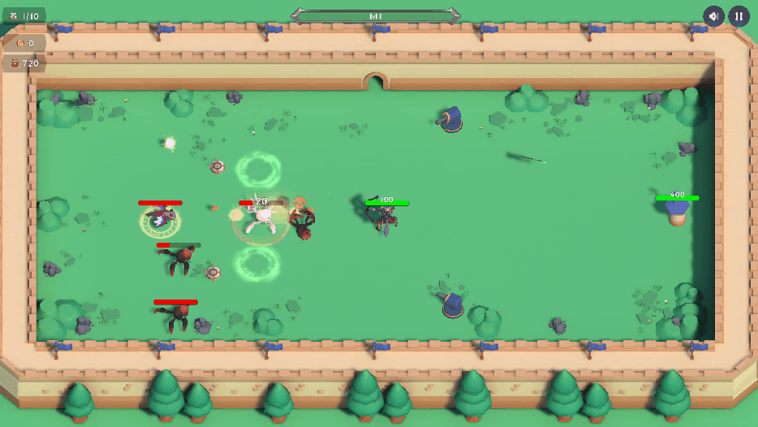
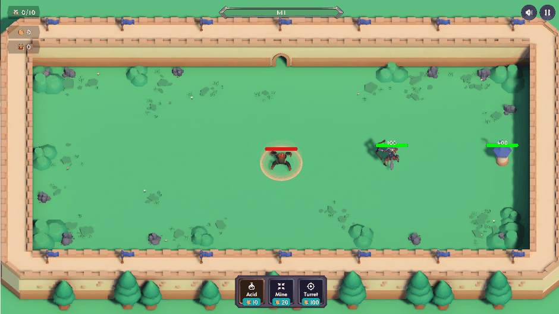
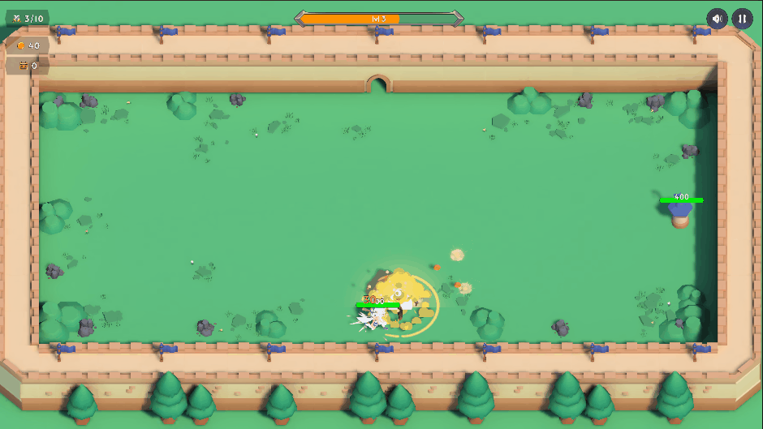
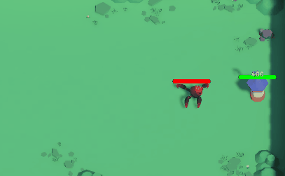
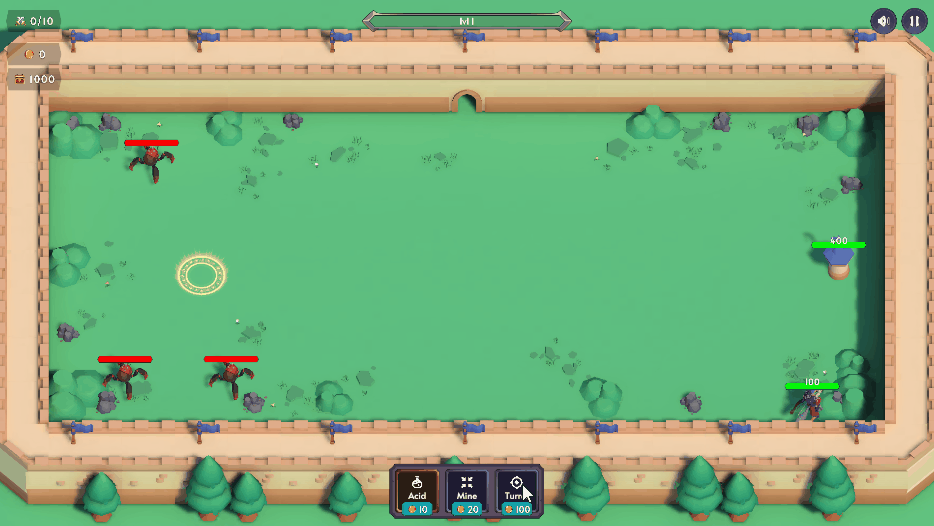
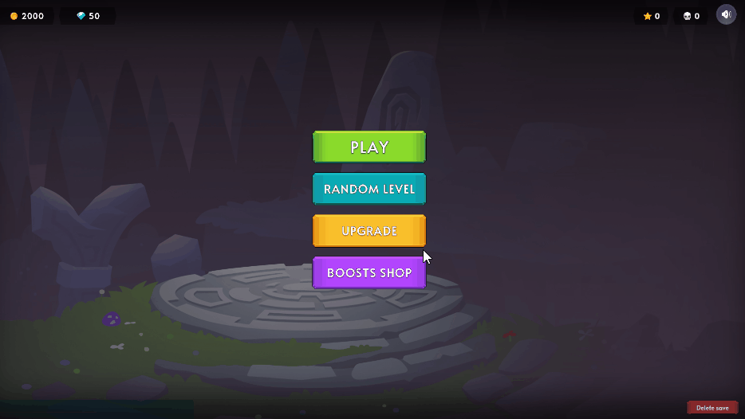

# Roguelike Tower Defense



**[▶ Играть в браузере (itch.io)](https://trez0r.itch.io/rogueliketd)** · Unity 6 · C# · ООП + ECS · VContainer · UniTask · URP

Защита башни в духе Archero: герой-лучник держит оборону от волн варваров и драконов, по ходу боя получает уровни и выбирает способности, а между забегами прокачивается в меню.

Личный проект — прототип с прицелом на дальнейшую разработку и релиз.

## Механики

### Управление как в Archero



Ходьба на WASD, остановился — герой сам стреляет в ближайшего врага в радиусе атаки.

### Способности за уровень



Опыт с врагов поднимает уровень героя прямо в бою — на выбор 3 карточки: дополнительные стрелы, отскок от врагов, усиление статов. Каждый 5-й уровень — легендарный выбор.

### Враги



Варвар бежит к ближайшей цели и взрывается. Дракон держит дистанцию и стреляет огненным шаром с упреждением — от него надо уходить. Враги переключаются с башни на героя, если он подошёл близко.

### Постройки



Монеты, собранные в бою, можно сразу потратить на защиту: турель, мину или лужу кислоты.

### Прогресс между забегами



Часть монет остаётся даже после поражения — их тратишь на постоянные улучшения героя. За победы дают алмазы для магазина разовых бустов.

## Архитектура

Код разбит на сборки (asmdef): `Core` — движок без игрового кода, `Game` — игра, `Editor` — инструменты, `Tests.EditMode` — тесты.

- **DI — VContainer.** Области жизни проекта и сцен создаются из кода, регистрации — установщики `IInstaller`, игровой цикл боя — точка входа `ITickable`. Раньше был самописный контейнер в роли service locator — перевёл и убрал 205 вызовов `Resolve`.
- **Сущности — своя entity-component модель.** `Entity` + компоненты-данные + системы, привязанные к сущности; удобный API для компонентов генерируется кодом.
- **Реактивность** — свои `ReactiveVariable` / `ReactiveEvent` с семантикой (старое, новое значение).
- **UI — MVP.** Окна открываются через `await` и возвращают результат, решения принимает вызывающий код.
- **Асинхронность — UniTask** с отменой через `CancellationToken` владельца.
- **ИИ — State Machine.** Поведение врагов собирается из конечных автоматов (поведение / атака / движение).
- **Баланс — в ScriptableObject:** сила врагов задаётся на каждую волну, уровни, статы, лут.
- **Сохранения** через интерфейс хранилища: на ПК — файл, в WebGL — PlayerPrefs (IndexedDB браузера).
- **Тесты** — 127 EditMode-тестов (NUnit) на ядро и сервисы.

## Инструменты разработки

- **Отладочный запуск** — окно в редакторе и CLI-команды: старт с любого уровня и волны, бессмертие, спавн врагов, выдача способностей. Работает только с отдельным отладочным сохранением.
- **Трекер прохождения** — пишет события боя в JSONL (волны, урон, уровни, постройки); по этим логам подбирался баланс.

## Структура

```
Assets/_Project/
├── Develop/Core      — ядро: реактивность, машина состояний, сохранения, загрузка сцен
├── Develop/Runtime   — игра: Gameplay, Meta, UI, Configs, Infrastructure
├── Develop/Editor    — генераторы кода, отладочный запуск
├── Tests/EditMode    — тесты
└── Resources         — конфиги и префабы
```

## Запуск проекта

Unity 6000.4.2f1 (URP). Платные арт-паки по лицензии нельзя выкладывать, поэтому их нет в репозитории: проект откроется без моделей и UI-графики. Поиграть можно в браузере по ссылке выше.

## Стек

Unity 6 · URP 17 · C# · ООП + ECS · VContainer · UniTask · DOTween · Cinemachine · NavMesh · Newtonsoft.Json · NUnit
